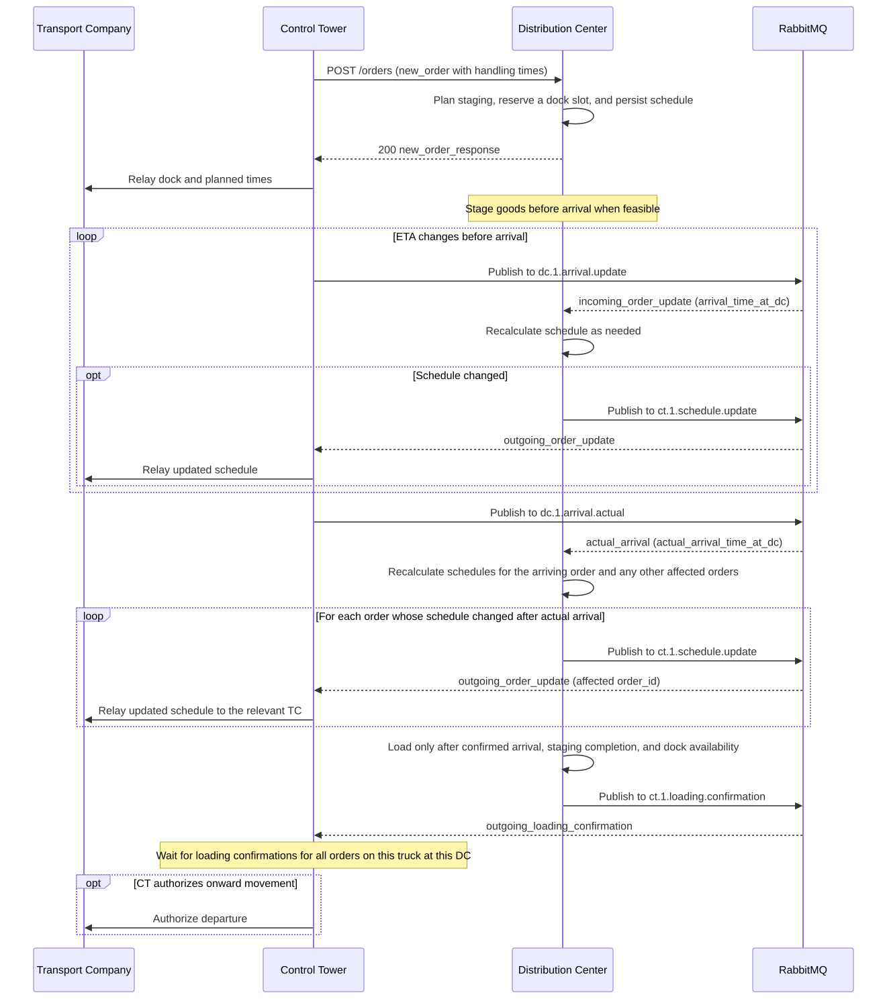

# BPIL Integration Contracts

This repo defines how Control Towers (CTs) and Distribution Centers (DCs) coordinate orders: REST for synchronous requests and RabbitMQ for asynchronous updates.

## Where to look

- [`docs/`](docs/) — Start with the [integration contract](docs/integration-contract.md) and its service catalogue for message names and routing keys. This folder also contains the actor registry, ontology, and setup guides for [Mendix](docs/mendix-setup-guide.md) and [RabbitMQ](docs/rabbitmq-setup.md).
- [`contracts/`](contracts/) — OpenAPI YAML for the DC REST API and AsyncAPI YAML for CT and DC RabbitMQ messaging. See the published API docs below for a human-readable format.
- [`diagrams/`](diagrams/) — Diagrams of the collaboration overview and complete order flow.

## Published API docs

- [REST API docs (Swagger UI)](https://wouter-deen.github.io/bpil-dc-integration/): browse the DC OpenAPI contract. Try it out is disabled because the server URL is an illustrative localhost endpoint.
- [RabbitMQ docs (AsyncAPI)](https://wouter-deen.github.io/bpil-dc-integration/asyncapi/): browse the DC and CT channels, operations, and messages.

Pushes to `main` redeploy both pages together.

## Integration flow

### Collaboration overview

### Complete order flow

