# Communication with DCs

How control towers (CTs) can communicate with distribution centers (DCs) and vice versa is described in the [integration contract](docs/integration-contract.md).

# BPIL Integration Contracts

- [REST API docs (Swagger UI)](https://wouter-deen.github.io/bpil-dc-integration/): browse the DC OpenAPI contract. Try it out is disabled because the server URL is an illustrative localhost endpoint.
- [RabbitMQ docs (AsyncAPI)](https://wouter-deen.github.io/bpil-dc-integration/asyncapi/): browse the DC and CT channels, operations, and messages.

Pushes to `main` redeploy both pages together.
