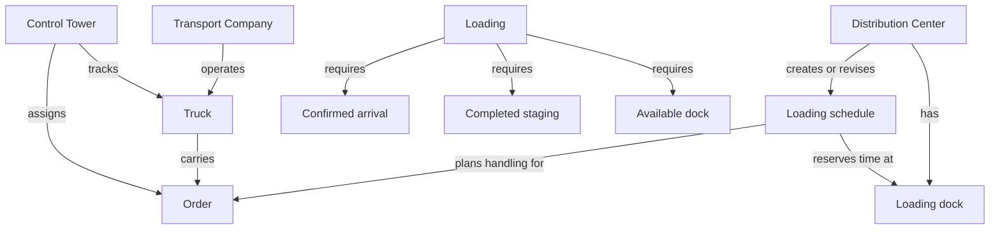

# BPIL integration ontology

This guide is based on the [formal OWL ontology](ontology.ttl), which you can open in [Protégé](https://protege.stanford.edu/). For message names, routing keys, and payload details, see the [integration contract](integration-contract.md#service-catalogue).

## Domain terms

| Kind        | Term                            | Meaning                                                                                                                                                                                                          |
| ----------- | ------------------------------- | ---------------------------------------------------------------------------------------------------------------------------------------------------------------------------------------------------------------- |
| Actor       | Distribution Center (DC)        | Stages goods, plans dock slots, and loads trucks. Communicates with the CT, not directly with the TC.                                                                                                            |
| Actor       | Control Tower (CT)              | Coordinates tendering and consolidation, tracks truck movements, calculates staging and loading durations, and relays schedules to the executing TC.                                                             |
| Actor       | Transport Company (TC)          | Operates trucks, calculates bids, and executes transport. Its interface with the CT is outside this contract.                                                                                                    |
| Actor       | Customer                        | Destination where goods are unloaded. No customer interface is defined here.                                                                                                                                     |
| Object      | Order                           | Quantity of goods to transport. The CT allocates its globally unique ID and assigns it to one truck. An order is not split across trucks.                                                                        |
| Object      | Truck                           | Vehicle that can carry one or more orders within its 100 QU capacity. Exactly 100 QU is a full truckload (FTL). A load of less than 100 QU is a less-than-truckload (LTL).                                       |
| Object      | Loading dock                    | DC-local resource that accommodates at most one truck at a time. The proposed rules give each DC three docks.                                                                                                    |
| Plan        | Loading schedule                | Per-order plan for a dock, a loading start, and an estimated departure. The DC creates it and may revise it as conditions change.                                                                                |
| Plan        | Dock slot                       | Reservation of dock time used to carry out a loading schedule. Not a separate wire object.                                                                                                                       |
| Activity    | Tendering and bid               | CT-coordinated carrier selection. TCs calculate bids from expected transport costs.                                                                                                                              |
| Activity    | Consolidation                   | Multiple orders assigned to one truck within its capacity. Those orders remain individually identified.                                                                                                          |
| Activity    | Staging                         | Preparing goods before loading. Staging may start before the truck arrives.                                                                                                                                      |
| Activity    | Loading                         | Putting staged goods onto a truck. Requires confirmed arrival, completed staging, and an available dock.                                                                                                         |
| Activity    | Journey and unloading           | Transport movement and removal of goods at the customer. A truck cannot travel during loading or unloading, or run simultaneous journeys.                                                                        |
| Time        | Estimated time of arrival (ETA) | Prediction of when a truck will reach the DC. An ETA can change and does not confirm arrival.                                                                                                                    |
| Time        | Actual arrival                  | Confirmed physical arrival at the DC.                                                                                                                                                                            |
| Time        | Estimated departure             | Planned departure, no earlier than planned loading start plus loading duration. Not a departure authorization or confirmation.                                                                                   |
| Measurement | QU, DU, CU                      | Shared quantity, distance, and cost units. CU supports CT/TC carrier selection, not DC billing.                                                                                                                  |
| Measurement | Timestamp and duration          | Timestamps are UTC ISO 8601 strings at whole-second precision. Durations are integer seconds, with calculated durations rounded up. Simulation uses synchronized system clocks, not a separate simulation clock. |

## Relationships

Read each arrow as a subject–relationship–object statement. The graph shows responsibilities and dependencies, not API calls.

One arrival can affect schedules for other orders. The DC reports one update per changed order, using that order’s `order_id`. For a consolidated truck, the CT waits for loading completion for **all** its orders at that DC before authorizing onward movement. See the [order lifecycle](../diagrams/order-lifecycle.svg) for the sequence.

## Transport terms

| Term                          | Meaning                                                                                                                                                                                                       |
| ----------------------------- | ------------------------------------------------------------------------------------------------------------------------------------------------------------------------------------------------------------- |
| REST / OpenAPI / Swagger UI   | Synchronous order submission and schedule response. OpenAPI defines the contract, and Swagger UI lets you browse it.                                                                                          |
| RabbitMQ / AMQP / AsyncAPI    | Asynchronous order updates, arrivals, schedule changes, and confirmations. AMQP is the broker protocol and AsyncAPI describes the channels, operations, and messages.                                         |
| Broker / virtual host         | RabbitMQ service and the namespace for its messaging resources (example virtual host: `/`).                                                                                                                   |
| Direct exchange               | `bpil.v1` routes publications by exact routing-key match to bound queues.                                                                                                                                     |
| Queue / binding / routing key | A queue holds deliveries for its consumer. A binding connects a queue to the exchange using a key. A publisher supplies the routing key on a message. Example inbound queues: `bpil.dc.1.in`, `bpil.ct.1.in`. |
| Actor registry                | Records actor instance IDs, REST base URLs, queues, and contacts. The repo entries are examples, not production addresses.                                                                                    |
| Mendix                        | Application platform used in the repo’s setup guide to connect to REST and RabbitMQ.                                                                                                                          |

See the [RabbitMQ topology](rabbitmq-setup.md), [actor registry](actor-registry.md), and [Mendix setup guide](mendix-setup-guide.md) for configuration.
